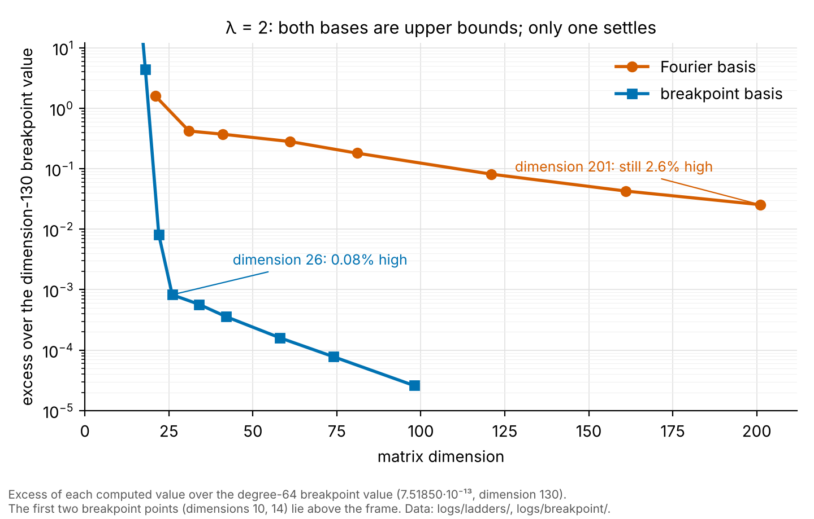

# An Improved Computation of the Truncated Weil-form Minimizer: Breakpoints at the Prime-power Positions

*Author: Jeff Echt. This analysis was produced with the assistance of Anthropic's Claude (Fable 5.1). Every computation was run by the author, who is responsible for all content. October 2026.*

**Background.** By Weil's criterion [1], in the form given by Bombieri [13, Theorem 2] and used in [2, 11], the Riemann Hypothesis is equivalent to the positivity of a quadratic form Q_W(f) = W(f ∗ f̃), where W is the explicit-formula functional: pole terms, minus a sum over prime powers weighted by Λ(p^m) p^{−m/2}, minus an archimedean term. Yoshida [14] showed that it is enough to test functions supported on a fixed interval [λ⁻¹, λ] for every λ. Connes, Consani and Moscovici [2] restrict Q_W to functions supported on [λ⁻¹, λ] and compute its lowest eigenvalue ε_λ and minimizer ξ_λ in a basis of 2N+1 complex exponentials, the Fourier basis. The restricted form is positive, ε_λ is tiny, and an operator built from ξ_λ has the zeta zeros as eigenvalues to tens of digits. Groskin [3, 4], Zhu [5], Connes [6] and others [7, 8] have since reimplemented and extended the computation, all in the same Fourier basis. They have used its values of ε_λ to test the large-λ decay heuristic of Connes [6], and its convergence rate in N as a measure of the regularity of ξ_λ.

**Abstract.** This note shows that the Fourier basis does not converge to ε_λ at any practical size, explains why, and gives a basis that does. At dimension 201 the Fourier value is at least 2.6%, 14% and 27% above the minimum at λ = 2, 2.5 and 3, and extrapolations of it are 5–20% too high. Two conclusions in the literature rest on these unsettled values. Groskin's convergence exponents [3, Table 14] measure the length of a transient, not the regularity of ξ_λ. The saturation in his c = 23 ladder [3, Table 8], which he attributes to a precision floor, is the minimum itself to within a factor of 2–3. The cause of the slow convergence is that ξ_λ has corners, interior points where it is not smooth. The prime term for p^m couples ξ(u) to ξ(p^m u). The partner point p^m u leaves the window at u = λ/p^m, and the coupling switches off there. So ξ_λ has a corner at y = L − log p^m and, by the symmetry of the form, a second corner at y = log p^m, where y = log λu and L = 2 log λ. There is one such pair for each prime power p^m ≤ λ²; at λ = 2 the prime powers 2, 3 and 4 give corners at y = log 2, log 3 and log 4 and at their mirror images L − log 2, L − log 3 and L − log 4 (at this λ, log 4 falls on the window end and log 2 is its own mirror image, so three interior cut positions remain). Whether each corner is a kink or a jump in the value is not determined here; both spoil Fourier convergence in the same way. The remedy is the hp finite-element basis of Babuška and his coworkers [9, 10], in which the interval is cut into pieces and the function is approximated by a polynomial on each piece (h refers to the piece size, p to the polynomial degree). Its known property is that it converges fast when the cuts are placed at the points where the function is not smooth. We place the cuts at the 2k points log p^m and L − log p^m, one pair for each of the k prime powers p^m ≤ λ². This basis comes within 0.1% of its dimension-130 value already at dimension 26 at λ = 2, and its values at λ = 2, 2.5 and 3 (dimensions 98, 149 and 225) are within roughly 0.01%, 0.1% and 0.5% of the minimum, assuming the sequence of values continues to contract at its observed rate (Section 1). A displacement control confirms the positions: the same cuts moved by 0.05, or placed at the midpoints between the prime positions, give a worse value at equal dimension. With settled values, the offset log ε_λ − log(1 − χ₄(λ)) plotted in Figure 4 of Connes, Consani and Moscovici [2] is flat to ±0.2 over λ = 2 to 3; Fourier values make it drift. All code, logs and eigenvectors are provided.

## Setting

In [2], the Weil form is restricted to functions on [λ⁻¹, λ] spanned by the 2N+1 lowest eigenfunctions V_n of the scaling operator. In the variable y = log λu these are the complex exponentials e^{2πiny/L} with n = −N, …, N, so we call this the Fourier basis. From the lowest eigenvector ξ_λ the authors build a rank-one perturbation D_log^{(λ,N)} whose spectrum approximates the zeros of ζ(½ + is). Their Figure 4 shows that log ε_λ tracks log(1 − χ₄(λ)), the time-band-limiting defect of a prolate function. Groskin's second paper [4] proves that every value of the truncated form is an exact sum over zeta zeros. Zhu [5] gives certified positivity with a simple even ground state for λ ≤ 2.23, certified upper bounds on ε_λ up to λ = e², and a Landau–Widom decay law. Silva [7] gives independent computations and exact formulas for the matrix entries, and Mehennaoui [8] shows that a simple lowest eigenvalue forces an even ground state, so that the two structural hypotheses of [2] reduce to one. Suzuki [11] gives a different operator realization of the same form through the screw function, in the variable a = log λ, and shows that his lowest eigenvalue and eigenfunction are ε_λ and ξ_λ. Kim et al. [12] discretize Suzuki's operator with uniform piecewise-linear finite elements, in the regime a ≤ 0.6 (λ ≤ 1.8) where the lowest eigenvalue is 10⁻⁶ or larger; they make the same point about Galerkin upper bounds as Section 1 below, and they place no mesh points at the prime positions.

We implemented the computation of [2] ourselves, from the formulas of that paper rather than from any published code: the matrix of Q_W in the Fourier basis, its lowest eigenvalue ε_λ and eigenvector ξ_λ, and the spectrum of D_log^{(λ,N)}. The matrix entries were checked in two ways. Every run compares three entries of the pole term with the paper's closed form, and a separate short script, sharing no code with the rest, recomputes one full matrix entry directly from the definition of Q_W. The closed-form comparison agrees to the working precision, and the recomputed entry to all printed digits (logs in `logs/validation/`). Where we overlap this literature, our numbers agree: the zeta-zero accuracy (2·10⁻³⁴ at λ = 3 with a 121×121 matrix), simplicity and evenness of the ground state at every λ run, and the e^{−4πλ²} decay. Those are checks, not results. The two observations below are not in that literature.

## 1. The Fourier values of ε_λ are biased upward, and the convergence diagnostics built on them are misleading

The Fourier value ε_N is a Galerkin upper bound. That is, it is the minimum of the Rayleigh quotient Q_W(f)/‖f‖² over the 2N+1-dimensional subspace, so it cannot be below the true minimum ε_λ, and it can only decrease as N grows. It converges slowly. There is a fast initial phase, which ends near N ≈ 30 at λ = 2.5 and near N ≈ 40 at λ = 3. After it, the local convergence exponent is unstable and lies between 0.3 and 2. At N = 100, a 201×201 matrix, ε_N is 2.6%, 14% and 27% above the best breakpoint values ε_λ = 7.5187·10⁻¹³, 4.7414·10⁻²⁴ and 2.470·10⁻³⁸ at λ = 2, 2.5 and 3 (obtained in Section 2). Extrapolations of the 1/N type are 5–20% too high.

The two values being compared are Galerkin upper bounds on the same minimum ε_λ: the Fourier value ε_N comes from the basis of [2], the one used throughout the literature, and the breakpoint value from the basis this note introduces in Section 2. Each is a true upper bound provided its matrix entries are exact. The entries of the breakpoint matrix are computed by numerical quadrature; at degrees 20 and 32 they are unchanged to 15–16 digits when the quadrature rule is refined. The last steps of the breakpoint ladders (the sequence of values as the degree increases) are 5·10⁻⁵, 4·10⁻⁴ and 5·10⁻³ in relative terms at λ = 2, 2.5 and 3. If the ladders continue to contract at their observed rate, the breakpoint values are within roughly 0.01%, 0.1% and 0.5% of the minimum. The Fourier excess over the breakpoint values needs no such assumption: both are upper bounds on the same quantity, so the excess is a lower bound on the Fourier error. The contraction assumption was given one out-of-sample test. With the estimates above already fixed, a degree-64 run at λ = 2 (dimension 130) was made; continued contraction predicted a value between 7.5183 and 7.5186·10⁻¹³, and the run gave 7.51850·10⁻¹³, the step from degree 48 (2.6·10⁻⁵ relative) being half the step before it.



*Figure 1. Every value at λ = 2 is a Galerkin upper bound on ε_λ; each is plotted as its relative excess over the lowest value computed, the dimension-130 breakpoint value. Every point is from a log in `logs/ladders/` or `logs/breakpoint/`; the figure is drawn by `make_figure.py`.*

Groskin's "Sobolev regularity exponent" s(c) ≈ 9–75 [3, Table 14] is a three-point power-law fit of ε_N over N ∈ {40, 60, 80} at c = λ² = 13, …, 43. At c = 9, the fast phase ends near N = 40. The exponent just past it is about 2 (1.99 and 1.88 on the next two steps, then 0.59). At larger c, the fit sits inside the fast phase. It then measures the length of the transient, not the regularity of ξ_λ. His own Table 8 at c = 23 shows this. There, λ_min falls by a factor of 4.6·10⁵ between N = 100 and N = 140, where a tail exponent of 2 would give a factor of 2. His N = 140 value, 9.0·10⁻¹¹³, is a factor of 1.4 above the value 6.6·10⁻¹¹³ predicted at λ² = 23 by our decay law log ε_λ = −4πλ² + 9 log λ + 16.6 (constant fitted at λ = 3). That extrapolation is good to perhaps a factor of 2–3. The saturation that he attributes to a 150-digit precision floor is therefore, within that factor, near the minimum rather than at the floor, which lies 38 digits below. His ladder still moves by a factor of 3.5 from N = 120 to N = 140. His N = 140 value is thus a Fourier upper bound, like our own N = 100 values. (His §8.2 mechanism for s(c) was withdrawn in his August 2026 errata; the Table 14 values stand.)

## 2. The minimizer is non-smooth at the prime-power positions, and a piecewise-polynomial basis with breakpoints there computes ε_λ

**Why the corners are where they are.** The reason lies in the Euler–Lagrange equation. The prime part of the form acts on ξ by −Σ Λ(p^m)p^{−m/2}[ξ(p^m u) + ξ(u/p^m)], restricted to [λ⁻¹, λ]. Here Λ is the von Mangoldt function, Λ(p^m) = log p, and the sum runs over the prime powers p^m ≤ λ². Each term evaluates ξ at p^m u. That point leaves the window when u passes λ/p^m, so the prime part jumps there by Λ(p^m)p^{−m/2}·ξ(λ). The archimedean operator is of order zero (it involves no derivatives) and cannot smooth a jump. Therefore ξ_λ is non-smooth at y = log p^m and at y = L − log p^m, with an amplitude proportional to its endpoint value. The same structure can be read directly from Suzuki's explicit form of the operator [11, eq. (2.11)]: in his variable x = y − a ∈ (−a, a), the prime term is −Σ Λ(n) n^{−1/2} (v(x − log n) + v(x + log n)), and the two shifted copies are supported on (−a + log n, a) and (−a, a − log n) [11, eq. (2.5)]. Their interior endpoints, x = −a + log n and x = a − log n, are y = log n and y = L − log n.

**The basis.** We now turn from the Fourier basis to the breakpoint basis. It is the hp finite-element construction [9, 10], also called the spectral-element method: the interval is cut into pieces at the known non-smooth points of the function, and on each piece the function is represented by a polynomial of degree d. (In the finite-element literature h is the piece size and p the polynomial degree; we write d for the degree.) Each piece carries d + 1 coefficients (degrees 0 through d), and keeping only even functions halves the total, so the dimension of the basis is about (d + 1) × (number of pieces) / 2. Coinciding cut positions merge: at λ = 2, log 2 = L/2 is its own mirror image and log 4 = L is the window end, so the six candidate positions give three interior cuts and four pieces; degree 12 then gives dimension 26 and degree 48 gives 98. The construction is standard; the content specific to the Weil form is where the cuts go. Such functions lie in the domain of the closed form Q_W restricted to L²(λ⁻¹, λ) that [2] and [11] work with, which contains functions with jumps; the smoothness of the Fourier basis was never required by the problem. There is a division of labor. The piecewise basis holds ξ_λ between the points where it is not smooth. The Fourier transform needed to evaluate the form at the zeros is then computed in closed form from the pieces: the transform of the whole function is the exact sum of per-piece integrals, each a polynomial against an oscillation, so the corners, which lie at the seams between pieces, cost nothing. This avoids asking one Fourier basis both to represent a non-smooth function and to read its spectrum.

**Three tests.** The claim that the cuts belong at the prime-power positions, and nowhere else, was tested in three ways. The first test asks whether the positions matter: would cuts somewhere else do as well? The second asks whether the sizes of the corners are the ones the Euler–Lagrange equation predicts. The third asks whether the breakpoint value of ε_λ is real, by recomputing it without the breakpoint matrix. All three are logged.

- *Positions.* At equal dimension, a basis with breakpoints at log p^m gives a lower ε than the same breakpoints shifted by 0.05, and a lower ε than breakpoints placed at the midpoints between the prime positions. At λ = 2.5 and degree 20, the values are 4.7462·10⁻²⁴ (correct positions), 4.8020·10⁻²⁴ (shifted, +1.2%) and 4.8337·10⁻²⁴ (midpoints, +1.8%). At λ = 2.2, the excess of the shifted set is 1.9%, 1.3% and 0.94% at degrees 12, 16 and 20. These excesses are 10–50 times the step-to-step change of the correct ladder. The per-piece coefficients of the displaced bases do not cleanly localize the difference, because piece width is confounded with position, so no per-piece claim is made. We also ran a residual scan in a plain Legendre basis (polynomials on the whole interval with no cuts). The scan evaluates how badly the computed minimizer fails the Euler–Lagrange equation near each candidate position. It shows no preference for the prime positions at λ = 2.2 and 2.5: it detects the non-smoothness but not its location.
- *Amplitude.* At each cut, the jump in the value of ξ_λ was evaluated from the two adjacent polynomial pieces and divided by Λ(p^m)p^{−m/2} times the endpoint value. The result is positive at each log p^m, that is, the jump has the sign of the endpoint value; the mirror cut repeats it with the opposite sign, by the evenness of the basis. It is nearly the same across prime powers at fixed degree: within 10% at λ = 2.5 and degree 32, where the weights Λ(p^m)p^{−m/2} span a factor of 2.1; within a factor of 1.5 at degree 16; and within 5–17% at λ = 2.2. The prime weight, the proportionality to the endpoint value and the sign are what the Euler–Lagrange equation predicts. The ratio is not a constant. It falls with the degree at every cut: from 0.16–0.23 at degree 16 to 0.13–0.14 at degree 32 at λ = 2.5, and from 0.19 to 0.119 over degrees 12–64 at λ = 2, with no visible floor. So the corner is neither a resolved jump nor a resolved kink, and the type of the singularity is not claimed.
- *Matrix-free check.* The breakpoint value at λ = 2 (degree 20) is reproduced by the explicit-formula zero sum Σ_ρ|ξ̂(t_ρ)|², computed from the eigenvector alone: 99.2% from 3000 zeros, and 99.95% with a fitted t^{−2.07} tail. It is therefore the value of the form on that function, not an artifact of the breakpoint matrix.

**What the basis delivers, and what it does not.** With 26 functions at λ = 2, the breakpoint basis reaches a value of ε below the Fourier value at dimension 121 and below the Legendre value at degree 48, while a Fourier run at dimension 201 is still 2.6% above the best breakpoint value, hence at least 2.6% above the minimum. At λ = 3, it gives ε to 1% at dimensions 150–225, where the Fourier basis at dimension 201 is 27% high. What remains after the prime-position breakpoints is a non-analytic component at the level of 10⁻³ times the endpoint value. It sits at the window ends, where a coefficient-decay estimate gives an exponent α ≈ 0.3–0.4 at λ = 2, and on the prime-bounded interior pieces. The same argument predicts weaker second-order positions at log p^m − log q^k. These are not detected: at λ = 3, extra cuts at the predicted positions and extra cuts at arbitrary positions in the same piece lower ε by the same amount. No polynomial basis is spectral for this function. The cost of the breakpoint basis grows with the number of prime powers ≤ λ². With a uniform per-piece degree it would be impractical beyond λ ≈ 4.2.

## 3. The Figure 4 comparison with settled values

Figure 4 of [2] plots log ε_λ against log(1 − χ₄(λ)). With breakpoint values of ε_λ, the offset log ε_λ − log(1 − χ₄(λ)) is 1.78, 2.12 and 2.09 at λ = 2, 2.5 and 3, flat to ±0.2 on three points. With the best Fourier values (N = 30, 100 and 60) it is 2.03, 2.26 and 2.51 and rising, and at λ = 3.5 (N = 60, Fourier only) it is at most 2.94. That rise is the Fourier truncation error, not a property of ε_λ. Any test of a decay heuristic for ε_λ against computed values has to use values that have settled. At λ ≤ 3 the breakpoint basis is the only one of the three bases tried that provides them.

## What is not claimed

Nothing here bears on λ → ∞. All computations have λ ≤ 4.2 and prime powers ≤ 17, where positivity is expected. Breakpoint values of ε_λ exist only for λ ≤ 3, and they are themselves upper bounds, still moving in the fourth digit. At λ = 3.5 and 4.2 only Fourier values exist; by extrapolation of the 2.6%, 14% and 27% excesses, they are probably 30% or more too high. The reading of Groskin's c = 23 ladder uses a decay law extrapolated from λ ≤ 3; we have not run c = 23. The type of the singularity at the prime positions is not determined, and no constant in the amplitude law is claimed. The second-order positions are a prediction that one controlled test did not detect. The endpoint exponent α is measured at one λ.

## Code, logs and reproduction

Everything is in the repository at [repository URL]. The scripts are Python 3 with mpmath: `weil_step1.py` (Fourier basis; spectrum of D_log; prolate comparison; `--zeros` for the explicit-formula sum; `--endpoint`; `--max-prime` and `--no-primes` for ablation), `weil_legendre.py` (Legendre basis), `weil_breakpoints.py` (breakpoint basis; `--extra-breaks` and `--no-breaks` for the controls), `bp_jumps.py`, `bp_zerosum.py`, `bp_piece_decay.py` and `leg_window.py` (diagnostics on dumped eigenvectors), and `check1.py` (one matrix entry recomputed from the definition). Every number in this note has a log in `logs/`, grouped by what produced it (`fourier/`, `fourier/ablation/`, `breakpoint/`, `breakpoint/controls/`, `legendre/`, `diagnostics/`, `validation/`, `ladders/`). `logs/INDEX.md` lists each log with its command and the numbers it backs. `tta_table.md` has the time-to-accuracy ladders of both bases. Precision is set with `--dps` (decimal digits). `--ygl` is the number of quadrature nodes per integration segment in the breakpoint basis; the default is max(24, 2d + 8). Every run in this note can be made on ordinary local hardware. The commands behind the headline numbers:

```
# Fourier values at N = 100 (the 2.6 / 14 / 27 % figures)
python3 weil_step1.py --lam 2   --N 100 --dps 50 --no-prolate --no-spectrum     # logs/fourier/lam2_N100.log
python3 weil_step1.py --lam 2.5 --N 100 --dps 60 --no-prolate --no-spectrum     # logs/fourier/lam25_N100.log
python3 weil_step1.py --lam 3   --N 100 --dps 90 --no-prolate --no-spectrum     # logs/fourier/lam3_N100.log

# best breakpoint values
python3 weil_breakpoints.py --lam 2   --d 48 --dps 50 --dump bp_lam2_d48_v2.json              # logs/breakpoint/lam2_d48.log
python3 weil_breakpoints.py --lam 2.5 --d 32 --dps 60 --ygl 32 --dump bp_lam25_d32.json   # logs/breakpoint/lam25_correct_d32.log
python3 weil_breakpoints.py --lam 3 --d 24 --dps 90 --ygl 32 --extra-breaks 0.28768,0.33647,0.47000   # logs/breakpoint/controls/lam3_d24_predextras.log

# displacement control at lambda = 2.5, degree 20 (correct, shifted by -0.05, midpoints)
python3 weil_breakpoints.py --lam 2.5 --d 20 --dps 60 --ygl 32 --dump bp_lam25_d20.json                                      # logs/breakpoint/lam25_correct_d20.log
python3 weil_breakpoints.py --lam 2.5 --d 20 --dps 60 --ygl 32 --no-breaks --extra-breaks 0.64315,1.04861,1.33629,1.55944    # logs/breakpoint/controls/lam25_shifted_d20.log
python3 weil_breakpoints.py --lam 2.5 --d 20 --dps 60 --ygl 32 --no-breaks --extra-breaks 0.11157,0.33472,0.56972,0.71356    # logs/breakpoint/controls/lam25_midpoint_d20.log

# amplitude at the cuts, and the matrix-free check
python3 bp_jumps.py bp_lam25_d20.json                                     # logs/diagnostics/bp_jumps_bp_lam25_d20.log
python3 bp_zerosum.py bp_lam2_d20.json --zeros-cache zeros.json           # logs/diagnostics/bp_zerosum_lam2_d20.log

# Legendre control and residual scan
python3 weil_legendre.py --lam 2.5 --M 120 --dps 60 --dump leg25.json ; python3 leg_window.py leg25_M120.json 60   # logs/legendre/leg25_M120.log, leg25_window.log

# full Fourier run with spectrum and prolate comparison (section 3 and the checks in Setting)
python3 weil_step1.py --lam 3 --N 60 --dps 100                            # logs/fourier/lam3_N60_full.log
```

## References

1. A. Weil, *Sur les "formules explicites" de la théorie des nombres premiers*, Comm. Sém. Math. Univ. Lund [Medd. Lunds Univ. Mat. Sem.] 1952, Tome Supplémentaire, 252–265.
2. A. Connes, C. Consani and H. Moscovici, *Zeta Spectral Triples*, arXiv:2511.22755 (2025).
3. A. Groskin, *High-Precision Approximation of Riemann Zeros via the Truncated Weil Form*, arXiv:2605.20224 (2026; v4 with errata, August 2026).
4. A. Groskin, *A finite Guinand–Weil dictionary and archimedean tail order for the truncated Weil quadratic form*, arXiv:2607.02828 (2026).
5. X. Zhu, *Weil positivity in compact windows: a finite reduction, certified two-sided bounds, and a Landau–Widom decay law*, arXiv:2608.24827 (v2, September 2026).
6. A. Connes, *The Riemann Hypothesis: Past, Present and a Letter Through Time*, arXiv:2602.04022 (2026), §6.
7. B. W. de Andrade Silva, *Quadrature sensitivity of deep spectra of truncated Weil forms, with corrections to two recent computational notes*, Zenodo, DOI 10.5281/zenodo.20650146 (2026); *A Loewner divided-difference formula for the prime contribution in the localized Weil quadratic form, and a parity sign law*, DOI 10.5281/zenodo.20710075 (2026); *A scalar Herglotz criterion for the even-simplicity hypothesis in the localized Weil quadratic form*, DOI 10.5281/zenodo.20694588 (2026).
8. S. Mehennaoui, *Evenness from Simplicity in the Truncated Weil Quadratic Form and Conditional Spectral Criteria for the Riemann Hypothesis*, Zenodo, DOI 10.5281/zenodo.23441946 (October 2026).
9. I. Babuška, B. A. Szabó and I. N. Katz, *The p-version of the finite element method*, SIAM J. Numer. Anal. 18 (1981), 515–545.
10. W. Gui and I. Babuška, *The h, p and h-p versions of the finite element method in 1 dimension*, Parts I–III, Numer. Math. 49 (1986), 577–683.
11. M. Suzuki, *Weil's quadratic form via the screw function*, arXiv:2606.09096 (2026).
12. T. Kim, Y. Hong, M. Kim, S. Choi, J. Jang and M. Kim, *A Numerical Realization of Suzuki's Weil-Quadratic-Form Operator: The Archimedean Spectral Law, its Universality, and an Operator Form of Weil's Positivity Criterion*, arXiv:2607.24830 (2026).
13. E. Bombieri, *Remarks on Weil's quadratic functional in the theory of prime numbers, I*, Atti della Accademia Nazionale dei Lincei, Classe di Scienze Fisiche, Matematiche e Naturali, Rendiconti Lincei, Matematica e Applicazioni, Serie 9, Vol. 11 (2000), n. 3, 183–233.
14. H. Yoshida, *On Hermitian forms attached to zeta functions*, in *Zeta functions in geometry*, Adv. Stud. Pure Math. 21, Kinokuniya, Tokyo (1992), 281–325.
